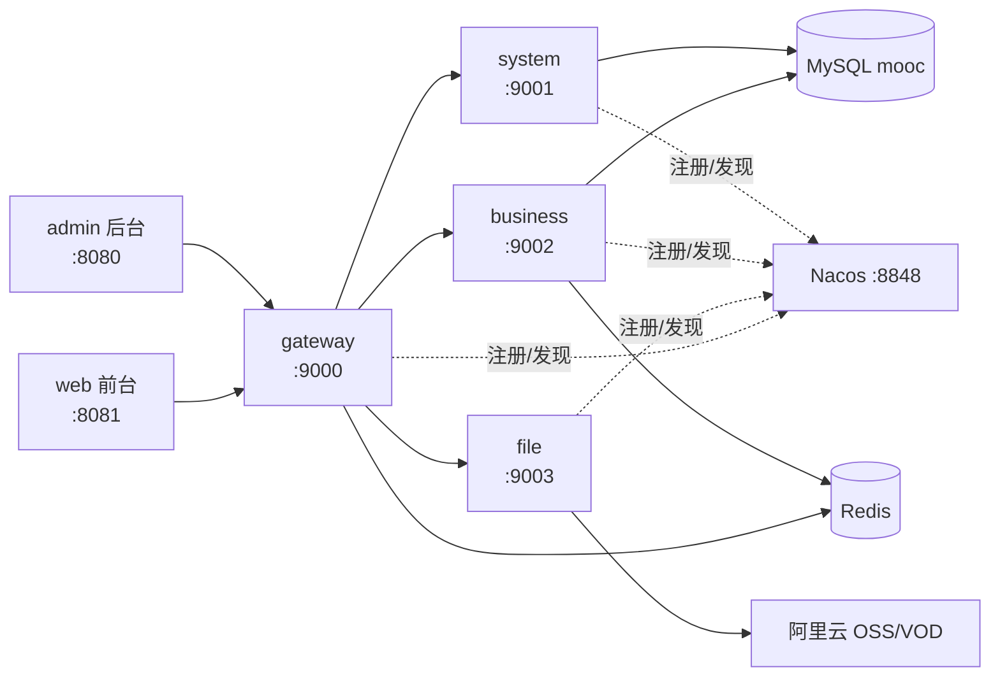

# fu-mooc 在线课程平台

基于 **Spring Cloud Alibaba + Vue 2** 的前后端分离在线课程平台，包含学员前台、运营后台和微服务后端三部分。
项目主要用来练习微服务拆分、网关鉴权、RBAC 权限、大文件分片上传、阿里云 OSS/VOD 集成，适合作为 Spring Cloud 入门的参考项目。

## 功能

| 模块 | 功能 |
| --- | --- |
| 学员前台 | 课程列表、分类筛选、课程详情、视频播放、手机号注册/登录、短信验证码 |
| 运营后台 | 课程、大章、小节、课程内容（富文本）、分类、讲师、会员、短信、文件管理 |
| 系统管理 | 用户、角色、资源（菜单 + 接口权限）的 RBAC 管理 |
| 文件服务 | 普通上传、大文件分片上传/断点续传/秒传、阿里云 OSS 存储、VOD 视频上传与加密播放 |

## 技术栈

| 层 | 选型 |
| --- | --- |
| 后端 | Spring Boot 2.2.2、Spring Cloud Hoxton、Spring Cloud Alibaba 2.2.1（Nacos） |
| 持久层 | MyBatis 2.2.2、MyBatis Generator、PageHelper 1.2.10、MySQL 8 |
| 网关 | Spring Cloud Gateway，自定义过滤器做登录校验 + 接口级鉴权 |
| 缓存 | Redis（登录 token） |
| 云服务 | 阿里云 OSS（对象存储）、VOD（视频点播）、短信服务 |
| 前端 | Vue 2.6、Vue Router 3、axios、vue-cli 5，`admin` 用 Ace Admin 模板 |
| 构建 | Maven 多模块、npm |

## 架构



## 模块说明

| 模块 | 端口 | 说明 |
| --- | --- | --- |
| `gateway` | 9000 | 统一入口，路径转发 + token 校验 + 接口权限校验 |
| `system` | 9001 | 用户、角色、资源，图形验证码 |
| `business` | 9002 | 课程、大章、小节、分类、讲师、会员、短信 |
| `file` | 9003 | 文件上传、分片续传、OSS/VOD |
| `server` | - | 公共 jar：domain、mapper、service、dto、工具类 |
| `generator` | - | 开发期用的代码生成器（读表结构生成 Controller/Service/Vue） |
| `eureka-server` | 8000 | **保留但已弃用**，各模块已切换到 Nacos |
| `admin` | 8080 | 运营后台（Vue） |
| `web` | 8081 | 学员前台（Vue） |

## 环境要求

| 依赖 | 版本 |
| --- | --- |
| JDK | 8 |
| Maven | 3.6+ |
| MySQL | 8.0+ |
| Redis | 5.0+ |
| Nacos | 2.x |
| Node.js | 16+（vue-cli 5 要求） |

## 快速开始

### 1. 初始化数据库

```bash
mysql -uroot -p < sql/mooc.sql
```

脚本会创建 `mooc` 库、18 张表，并写入演示数据（后台账号、角色权限、分类、两门示例课程）。

> 脚本是按代码里的 MyBatis mapper 反向重建的（原始库已丢失），字段长度/默认值为合理推断，与代码严格兼容。详见 [sql/mooc.sql](sql/mooc.sql) 头部说明。

### 2. 启动中间件

```bash
# Redis
redis-server

# Nacos（单机模式，2.x）
sh bin/startup.sh -m standalone      # Windows: bin\startup.cmd -m standalone
```

Nacos 控制台 <http://127.0.0.1:8848/nacos>，默认账号密码 `nacos/nacos`。

### 3. 配置环境变量

数据库、Redis、Nacos 都有本地默认值，一般不用改。**OSS/VOD 密钥必须配置**，否则 `file` 模块启动失败。

Windows PowerShell：

```powershell
$env:OSS_ACCESS_KEY_ID="your-ak"
$env:OSS_ACCESS_KEY_SECRET="your-sk"
$env:VOD_ACCESS_KEY_ID="your-ak"
$env:VOD_ACCESS_KEY_SECRET="your-sk"
$env:OSS_BUCKET="your-bucket"
$env:OSS_DOMAIN="https://your-bucket.oss-cn-beijing.aliyuncs.com/"
```

Linux / macOS：

```bash
export OSS_ACCESS_KEY_ID=your-ak
export OSS_ACCESS_KEY_SECRET=your-sk
export VOD_ACCESS_KEY_ID=your-ak
export VOD_ACCESS_KEY_SECRET=your-sk
export OSS_BUCKET=your-bucket
export OSS_DOMAIN=https://your-bucket.oss-cn-beijing.aliyuncs.com/
```

### 4. 启动后端

按顺序启动（都要先注册到 Nacos）：

```bash
mvn clean install -DskipTests

java -jar system/target/system-0.0.1-SNAPSHOT.jar
java -jar business/target/business-0.0.1-SNAPSHOT.jar
java -jar file/target/file-0.0.1-SNAPSHOT.jar
java -jar gateway/target/gateway-0.0.1-SNAPSHOT.jar
```

也可以直接在 IDEA 里跑各模块的 `*Application`。

### 5. 启动前端

```bash
cd admin && npm install && npm run serve-dev    # http://localhost:8080
cd web   && npm install && npm run serve-dev    # http://localhost:8081
```

打包产物在各自 `dist/` 目录。前端用的是 `history` 路由模式，部署到 nginx 时要配 `try_files $uri $uri/ /index.html;`。

## 默认账号

| 场景 | 地址 | 账号 | 密码 |
| --- | --- | --- | --- |
| 运营后台 | <http://localhost:8080> | `admin` | `admin123` |
| 学员前台 | <http://localhost:8081> | `13800000000` | `member123` |

密码入库前做了两层 md5：`md5(md5(明文 + KEY))`，其中 `KEY` 在前端 `public/static/js/md5.js` 里（默认 `!@#QWERT`）。要手写 SQL 加账号时注意这个规则。

## 配置说明

所有配置都在各模块的 `application.properties` 里，敏感项已改成占位符，可用环境变量覆盖：

| 变量 | 默认值 | 说明 |
| --- | --- | --- |
| `DB_HOST` / `DB_PORT` / `DB_NAME` | `127.0.0.1` / `3306` / `mooc` | 数据库 |
| `DB_USERNAME` / `DB_PASSWORD` | `root` / `123456` | 数据库账号 |
| `REDIS_HOST` / `REDIS_PORT` | `127.0.0.1` / `6379` | Redis |
| `NACOS_ADDR` | `127.0.0.1:8848` | Nacos 地址 |
| `SYSTEM_URI` | `http://127.0.0.1:9001` | 网关转发 system 的目标地址 |
| `FILE_PATH` | `D:/logs/course/upload/` | 本地上传目录，Linux 下建议 `/data/upload/` |
| `FILE_DOMAIN` | `http://127.0.0.1:9000/file/f/` | 文件访问前缀 |
| `OSS_ACCESS_KEY_ID` / `OSS_ACCESS_KEY_SECRET` | 无，**必填** | OSS 密钥 |
| `OSS_ENDPOINT` / `OSS_BUCKET` / `OSS_DOMAIN` | 阿里云华北2 示例值 | OSS 地址与桶 |
| `VOD_ACCESS_KEY_ID` / `VOD_ACCESS_KEY_SECRET` | 无，**必填** | VOD 密钥（可与 OSS 共用一对 AK） |

前端接口地址在 `admin/.env.dev`、`admin/.env.prod`、`web/.env.dev`、`web/.env.prod` 里改。

> 只想跑课程浏览/后台管理、不需要上传功能时，可以只启动 `system`、`business`、`gateway` 三个模块，跳过 `file`。

## 目录结构

```
fu-mooc
├── admin/          运营后台（Vue 2 + Ace Admin）
├── web/            学员前台（Vue 2）
├── gateway/        网关：路由 + 登录/权限过滤器
├── system/         系统管理服务
├── business/       业务服务
├── file/           文件服务（OSS/VOD/分片上传）
├── server/         公共模块：domain / mapper / service / dto / utils
├── generator/      代码生成器（开发期用）
├── eureka-server/  旧注册中心，已弃用
└── sql/mooc.sql    建库建表 + 演示数据
```

## 已知限制

- `eureka-server` 是早期用 Eureka 时留下的，配置里已全部注释，实际走 Nacos，**不用启动它**。
- 后端无单元测试（`src/test` 为空）。
- Spring Boot 2.2.2 / Spring Cloud Hoxton / fastjson 1.2.x 均已停止维护，存在已知 CVE。本项目偏教学用途，未做升级；用于生产请先评估依赖安全。
- `admin/public/ace`、`zTree_v3` 是第三方模板/插件，遵循其各自的授权协议，商用前请自行确认。

## License

[MIT](LICENSE)
